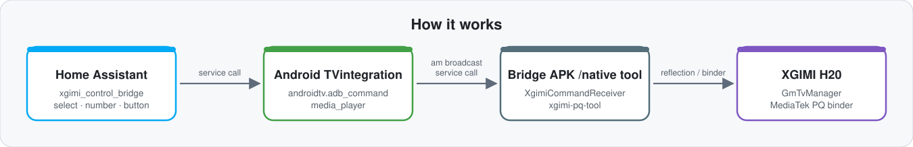

# XGIMI Control Bridge

[English](README.md) · **Deutsch**

[](https://hacs.xyz)


> **Tipp:** Für den Alltag gibt es inzwischen die vollständige Integration **[ha-xgimi-h20](https://github.com/dr-apple/ha-xgimi-h20)** – lokal per ADB, ohne Zusatz-App, mit allen Bildeinstellungen. Dieses Repo ist das experimentelle Vorgängerprojekt und die Reverse-Engineering-Sammlung dazu.

Die Home-Assistant-Integration in Version `0.1.18` ist mit Home Assistant
`2026.8` kompatibel und gegen `2026.8.1` getestet.

Kleine Android-App für XGIMI H20 / Android 14. Sie nimmt ADB-Broadcasts entgegen
und ruft über Reflection die private XGIMI-API `GmTvManager` auf. Dazu gehört eine
Home-Assistant-Integration, die die App und native MediaTek-PQ-Werkzeuge über die
Android-TV-Integration anspricht.



## Inhalt

- [Reverse-Engineering-Status](#reverse-engineering-status) · [Bauen](#bauen) · [Testbefehle](#testbefehle) · [Home-Assistant-Integration](#home-assistant-custom-integration) · [Dienste & Beispiele](#xgimi-middleware-diagnose)

## Reverse Engineering Status

Dieses Projekt wird jetzt zusätzlich als Reverse-Engineering-Repo für native
XGIMI-H20-Steuerung geführt. Ziel ist eine Home-Assistant-Integration ohne
DPAD-/Menü-Automatisierung.

Neue Struktur:

```text
apks/          lokale, ignorierte APK-Inputs
framework/     lokale, ignorierte Framework-/DEX-Inputs
libs/          lokale, ignorierte native Libraries
binder/        Binder-Service-Notizen
docs/          Analyseplan und Native-API-Map
scripts/       reproduzierbare Scan- und ADB-Testwerkzeuge
findings.md    fortlaufende Erkenntnisse
homeassistant/ Zielbild für die native HA-Integration
```

Wichtig: Firmware-APKs, Framework-JARs und `.so`-Dateien werden absichtlich nicht
ins öffentliche Git-Repo aufgenommen. Sie bleiben lokal und werden von den Skripten
analysiert.

Bestätigt ist bisher der native Autofokus-Aufruf:

```bash
adb shell service call xgimi.hardware.gmpf.IProjectorFocusManager/default 3 i32 2
```

Die bisherigen Picture-/MEMC-Aufrufe über `GmTvManager` erreichen zwar die App,
ändern aber den sichtbaren HDR10-Bildmodus nicht zuverlässig. Der aktuell stärkste
Lead für HDR Picture Mode, MEMC, Color Temperature, Gamma, Brightness und AI Picture
ist daher die MediaTek-PQ-Pipeline:

```text
Settings -> PqModeManager -> JNI -> vendor.mediatek.hardware.pq-impl.so -> GM_DISP_SCENE_V3
```

Bestätigt ist inzwischen ein nativer MediaTek-PQ-Statusleser:

```bash
scripts/xgimi_h20_adb.py -s <BEAMER-IP>:5555 pq-get-global-settings
```

Dieser liest direkt Werte wie `Picture_Mode`, `Backlight`, `Brightness`,
`Gamma`, `Color_Temperature`, `AI_PQ`, `MJC_Effect` und `Local_Contrast`.
Wichtig: Der dort gelesene `Picture_Mode` ist nicht der sichtbare OSD-Bildmodus.
Beim manuellen Wechsel von `Lebhaft` auf `Spiel` blieb der rohe native Wert auf
`ImaxEnhanced`; der echte Bildmodus liegt in der geschützten MediaTek
Settings-PQ-Datenbank beziehungsweise in der `PqModeManager`-Schicht.

Zusätzlich ist jetzt die OSD-nahe Java-Schicht gefunden: Google TV bindet
`com.mediatek.extservice` mit der Action `PqService.remote` und ruft
`com.mediatek.extservice.IPqService` auf. Besonders relevant ist
`setPqRepositoryByPkg(packageName, enable, json)`, weil dieser Pfad full-profile
JSON mit Source-/Paket-Ziel nutzt. Details stehen in `docs/extservice_ipq.md`.
Die Bridge `0.1.7` enthält dafür den ersten vorsichtigen Lesetest:
`de.drapple.xgimi.GET_EXT_PQ_SETTINGS`. Live getestet: der Dienst ist durch
`com.mediatek.tv.extservice.permission.USE_PQSERVICE` geschützt
(`signature|privileged`). Eine normal sideloaded APK kann ihn daher nicht direkt
binden; der Pfad bleibt als Diagnose und für mögliche privilegierte Installationen
dokumentiert.

## Bauen

Projekt in Android Studio öffnen und **Build > Build APK(s)** wählen.

Die APK liegt anschließend typischerweise hier:

```text
app/build/outputs/apk/debug/app-debug.apk
```

Installation:

```bash
adb install -r app-debug.apk
```

Die App hat absichtlich kein Launcher-Icon. Sie arbeitet nur als Broadcast-Receiver.

## Testbefehle

Bildprofil Film:

```bash
adb shell am broadcast -n de.drapple.xgimi/.XgimiCommandReceiver   -a de.drapple.xgimi.SET_PICTURE_MODE --es mode movie
```

Weitere Profile:

```text
bright, standard, soft, user, game, auto, pc, movie, natural, sports
```

MEMC:

```bash
adb shell am broadcast -n de.drapple.xgimi/.XgimiCommandReceiver   -a de.drapple.xgimi.SET_MEMC --es level high
```

MEMC-Werte:

```text
off, low, middle, high, bypass
```

Status abfragen:

```bash
adb shell am broadcast -n de.drapple.xgimi/.XgimiCommandReceiver   -a de.drapple.xgimi.GET_STATUS
```

Bestimmte Quelle erzwingen:

```bash
--ei source 0
```

Quellen laut XGIMI-API:

```text
0 = internes Google TV / MM
1 = HDMI 1
2 = HDMI 2
3 = HDMI 3
4 = HDMI 4
```

Direkte numerische Werte sind ebenfalls möglich:

```bash
adb shell am broadcast -n de.drapple.xgimi/.XgimiCommandReceiver   -a de.drapple.xgimi.SET_PICTURE_MODE --ei value 7
```

## Bekannte XGIMI-Werte

Bildprofile:

```text
0 bright
1 standard
2 soft
3 user
4 game
5 auto
6 pc
7 movie
8 natural
9 sports
```

MEMC:

```text
0 off
1 low
2 middle
3 high
4 bypass
```

## Home Assistant Custom Integration

### Installation mit HACS

1. HACS öffnen.
2. **Custom repositories** öffnen.
3. Repository hinzufügen:

   ```text
   https://github.com/dr-apple/XgimiControlBridge
   ```

4. Kategorie **Integration** auswählen.
5. **XGIMI Control Bridge** installieren.
6. Home Assistant neu starten.
7. In Home Assistant **Einstellungen > Geräte & Dienste > Integration hinzufügen**
   öffnen und **XGIMI Control Bridge** auswählen.
8. Die bestehende Android-TV-/ADB-`media_player`-Entity des Projektors auswählen.

### Manuelle Installation

Dieses Repository enthält zusätzlich eine Custom Integration unter:

```text
custom_components/xgimi_control_bridge
```

Manuelle Installation:

1. Den Ordner `custom_components/xgimi_control_bridge` nach Home Assistant in
   `/config/custom_components/xgimi_control_bridge` kopieren.
2. Home Assistant neu starten.
3. In Home Assistant **Einstellungen > Geräte & Dienste > Integration hinzufügen**
   öffnen und **XGIMI Control Bridge** auswählen.
4. Die bestehende Android-TV-/ADB-`media_player`-Entity des Projektors auswählen.

Die Integration legt zwei klassische Select-Entities für die alte XGIMI-Bridge an:

```text
select.xgimi_control_bridge_picture_mode
select.xgimi_control_bridge_memc
```

Für die bestätigte native MediaTek-PQ-Steuerung gibt es zusätzlich echte
HA-Regler:

```text
number.xgimi_control_bridge_native_pq_backlight
number.xgimi_control_bridge_native_pq_brightness
number.xgimi_control_bridge_native_pq_contrast
```

Diese Regler schreiben direkt über `vendor.mediatek.hardware.pq.IPq/default`
und lesen den Status danach wieder zurück. Auf deiner Anlage heißen sie je
nach gewählter Entity zum Beispiel:

```text
number.wohnzimmer_xgimi_control_bridge_native_pq_backlight
number.wohnzimmer_xgimi_control_bridge_native_pq_brightness
number.wohnzimmer_xgimi_control_bridge_native_pq_contrast
```

Die nativen Bildoptionen liegen als eigene Dropdowns daneben:

```text
select.wohnzimmer_xgimi_control_bridge_native_pq_gamma
select.wohnzimmer_xgimi_control_bridge_native_pq_color_temperature
select.wohnzimmer_xgimi_control_bridge_native_pq_ai_picture
select.wohnzimmer_xgimi_control_bridge_native_pq_memc
select.wohnzimmer_xgimi_control_bridge_native_pq_local_contrast
select.wohnzimmer_xgimi_control_bridge_osd_picture_mode
```

Wichtig: Der alte direkte `select.xgimi_control_bridge_picture_mode` wird nicht
mehr als Standard-Entity angelegt. Der XGIMI-Wrapper ändert den sichtbaren
HDR10/IMAX-Bildmodus auf dem H20 nicht zuverlässig.
Der frühere `select.*_native_pq_picture_mode` wurde ab `v0.1.12` entfernt,
weil der native Rohwert `Picture_Mode` nicht dem sichtbaren OSD-Bildmodus
entspricht. Der Wert bleibt als Diagnose-Sensor erhalten.

Ab `v0.1.11` nutzt die Integration zwei unterschiedliche native Schreibpfade:
globale PQ-Werte wie `Gamma`, `Color_Temperature` und `Backlight` laufen über
`setPqParamsByGlobal`; stream-/bildbezogene Werte wie `Brightness`, `Contrast`,
`MJC_Effect`, `AI_PQ` und `Local_Contrast` laufen über `setPqParams(0, json)`.

Zusätzlich gibt es Status-Sensoren und Buttons zum manuellen Aktualisieren:

```text
button.xgimi_control_bridge_refresh_all_status
button.xgimi_control_bridge_refresh_status
button.xgimi_control_bridge_refresh_native_pq_status
button.xgimi_control_bridge_autofocus
button.xgimi_control_bridge_open_picture_mode_osd
button.xgimi_control_bridge_picture_mode_previous
button.xgimi_control_bridge_picture_mode_next
button.xgimi_control_bridge_osd_confirm
button.xgimi_control_bridge_osd_back
select.xgimi_control_bridge_osd_picture_mode
sensor.xgimi_control_bridge_picture_mode
sensor.xgimi_control_bridge_osd_picture_mode
sensor.xgimi_control_bridge_memc
sensor.xgimi_control_bridge_source
sensor.xgimi_control_bridge_native_pq_hdr_type
sensor.xgimi_control_bridge_native_pq_backlight
sensor.xgimi_control_bridge_native_pq_brightness
sensor.xgimi_control_bridge_native_pq_contrast
sensor.xgimi_control_bridge_native_pq_saturation
sensor.xgimi_control_bridge_native_pq_hue
sensor.xgimi_control_bridge_native_pq_gamma
sensor.xgimi_control_bridge_native_pq_color_temperature
sensor.xgimi_control_bridge_native_pq_ai_picture
sensor.xgimi_control_bridge_native_pq_hdr_mode
sensor.xgimi_control_bridge_native_pq_color_space
sensor.xgimi_control_bridge_native_pq_memc
sensor.xgimi_control_bridge_native_pq_nr
sensor.xgimi_control_bridge_native_pq_mpeg_nr
sensor.xgimi_control_bridge_native_pq_local_contrast
sensor.xgimi_control_bridge_native_pq_low_latency
sensor.xgimi_control_bridge_native_pq_global_dimming
sensor.xgimi_control_bridge_native_pq_dark_detail
sensor.xgimi_control_bridge_native_pq_dynamic_color_booster
sensor.xgimi_control_bridge_native_pq_film_mode
sensor.xgimi_control_bridge_native_pq_picture_mode
sensor.xgimi_control_bridge_last_action
sensor.xgimi_control_bridge_last_command_ok
sensor.xgimi_control_bridge_last_adb_response
```

Der Status wird aus dem `adb_response`-Attribut der Android-TV-ADB-Entity gelesen.
Wenn Steuerung oder Status nicht funktionieren, zuerst den Button
**Refresh All Status** drücken und danach die nativen Sensoren prüfen.
Der Roh-ADB-Sensor wird absichtlich gekürzt, damit Home Assistant keine zu großen
Recorder-Attribute speichert.

Außerdem stehen Services zur Verfügung:

```text
xgimi_control_bridge.set_picture_mode
xgimi_control_bridge.set_memc
xgimi_control_bridge.get_status
xgimi_control_bridge.get_native_pq_status
xgimi_control_bridge.get_native_hdr_type
xgimi_control_bridge.set_native_pq_value
xgimi_control_bridge.get_ext_pq_status
xgimi_control_bridge.set_osd_picture_mode
xgimi_control_bridge.sync_osd_picture_mode
xgimi_control_bridge.autofocus
xgimi_control_bridge.open_picture_mode_osd
xgimi_control_bridge.osd_picture_mode_previous
xgimi_control_bridge.osd_picture_mode_next
xgimi_control_bridge.osd_confirm
xgimi_control_bridge.osd_back
```

Empfohlener OSD-Ablauf für den sichtbaren Bildmodus:

1. Einmal den aktuellen Modus synchronisieren:

```yaml
action: xgimi_control_bridge.sync_osd_picture_mode
target:
  entity_id: media_player.xgimi_h20
data:
  mode: Lebhaft
```

2. Danach den Select `select.xgimi_control_bridge_osd_picture_mode` benutzen
oder den Service direkt aufrufen:

```yaml
action: xgimi_control_bridge.set_osd_picture_mode
target:
  entity_id: media_player.xgimi_h20
data:
  mode: Film
```

Die Integration öffnet dabei das originale Picture-Mode-OSD, drückt die
kürzeste Links-/Rechts-Sequenz und schließt das OSD wieder. Wenn du mit der
Fernbedienung manuell umstellst, danach wieder `sync_osd_picture_mode`
aufrufen, damit HA und Beamer dieselbe Ausgangsposition kennen.

Autofokus:

```yaml
action: xgimi_control_bridge.autofocus
target:
  entity_id: media_player.xgimi_h20
```

Nativer MediaTek-PQ-Status:

```yaml
action: xgimi_control_bridge.get_native_pq_status
target:
  entity_id: media_player.xgimi_h20
```

Nativer MediaTek-PQ-Schreibzugriff, live bestätigt mit Backlight 40 -> 41 -> 40:

```yaml
action: xgimi_control_bridge.set_native_pq_value
target:
  entity_id: media_player.xgimi_h20
data:
  key: Backlight
  value: 40
```

OSD-nahe ExtService-PQ-Schicht:

```yaml
action: xgimi_control_bridge.get_ext_pq_status
target:
  entity_id: media_player.xgimi_h20
```

### XGIMI Middleware Diagnose

Ab Bridge-APK `0.1.9` kann der erreichbare XGIMI-MiscKey-Middleware-Service
diagnostisch abgefragt werden:

```bash
scripts/xgimi_h20_adb.py -s <BEAMER-IP>:5555 \
  bridge-middleware-exec-sync getBoostEnable
```

Bestätigt erreichbar sind zum Beispiel `getBoostEnable` und `getALOnOff`.
Die naheliegenden Picture-Mode-Kommandos `getPQMode`, `queryPQMode`,
`getPictureMode` und `getImageMode` liefern derzeit leer zurück; der sichtbare
Bildmodus ist also auch über diesen öffentlichen Middleware-Eingang noch nicht
freigelegt.

### Native MediaTek PQ Diagnose

Ab `v0.1.15` gibt es zusätzlich ein natives `armeabi-v7a` Shell-Werkzeug für
den MediaTek-PQ-Binder. Es läuft per ADB-Shell und umgeht damit die
Beschränkung, die normale sideloaded APKs bei `IPq.setMode` trifft:

```bash
native/build_xgimi_pq_tool.sh
scripts/xgimi_h20_adb.py -s <BEAMER-IP>:5555 native-pq-tool-push
scripts/xgimi_h20_adb.py -s <BEAMER-IP>:5555 native-pq-get-hdr-type --pq-id 0
scripts/xgimi_h20_adb.py -s <BEAMER-IP>:5555 native-pq-set-mode --display-mode-type 30
```

Live bestätigt: `native-pq-get-hdr-type` liest den Vendor-Binder erfolgreich.
`native-pq-set-mode` erreicht Returncodes, hat den sichtbaren HDR10-Bildmodus
aber noch nicht gelöst. Der nächste Schritt ist das Rekonstruieren der echten
Runtime-Werte für `DisplayModeSettingData`.

MEMC:

```yaml
action: xgimi_control_bridge.set_memc
target:
  entity_id: media_player.xgimi_h20
data:
  level: high
```

Die Integration nutzt intern weiterhin die Android-TV-ADB-Aktion. Der äquivalente
Rohbefehl wäre:

```yaml
action: androidtv.adb_command
target:
  entity_id: media_player.xgimi_h20
data:
  command: >-
    am broadcast -n de.drapple.xgimi/.XgimiCommandReceiver
    -a de.drapple.xgimi.SET_PICTURE_MODE
    --es mode movie
```

Hinweis: Das ist eine experimentelle Bridge gegen eine nicht dokumentierte Hersteller-API.
Nach Firmware-Updates können Methodennamen oder Berechtigungen geändert sein.

## Lizenz

Siehe [LICENSE](LICENSE). Kein offizielles XGIMI-Projekt.
