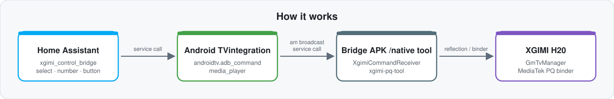

# XGIMI Control Bridge

**English** · [Deutsch](README.de.md)

[](https://hacs.xyz)


> **Tip:** for everyday use there is now the full integration **[ha-xgimi-h20](https://github.com/dr-apple/ha-xgimi-h20)** – local via ADB, no extra app, every picture setting. This repo is the experimental predecessor and its reverse-engineering collection.

The Home Assistant integration version `0.1.18` is compatible with Home Assistant `2026.8` and tested against `2026.8.1`.

A small Android app for the XGIMI H20 / Android 14. It receives ADB broadcasts and calls the private XGIMI API `GmTvManager` via reflection. It comes with a Home Assistant integration that drives the app and native MediaTek PQ tools through the Android TV integration.



## Contents

- [Reverse-engineering status](#reverse-engineering-status) · [Build](#build) · [Test commands](#test-commands) · [Home Assistant integration](#home-assistant-custom-integration) · [Services & examples](#services)

## Reverse-engineering status

This project also serves as the reverse-engineering repo for native XGIMI H20 control. The goal is a Home Assistant integration without D-pad/menu automation.

```text
apks/          local, ignored APK inputs
framework/     local, ignored framework/DEX inputs
libs/          local, ignored native libraries
binder/        binder service notes
docs/          analysis plan and native API map
scripts/       reproducible scan and ADB test tools
findings.md    running findings
homeassistant/ target design for the native HA integration
```

Important: firmware APKs, framework JARs and `.so` files are intentionally not committed to the public repo. They stay local and are analysed by the scripts.

Confirmed so far is the native autofocus call:

```bash
adb shell service call xgimi.hardware.gmpf.IProjectorFocusManager/default 3 i32 2
```

The earlier picture/MEMC calls via `GmTvManager` reach the app but do not reliably change the visible HDR10 picture mode. The strongest lead for HDR picture mode, MEMC, colour temperature, gamma, brightness and AI picture is therefore the MediaTek PQ pipeline:

```text
Settings -> PqModeManager -> JNI -> vendor.mediatek.hardware.pq-impl.so -> GM_DISP_SCENE_V3
```

A native MediaTek PQ status reader is confirmed:

```bash
scripts/xgimi_h20_adb.py -s <BEAMER-IP>:5555 pq-get-global-settings
```

It reads values such as `Picture_Mode`, `Backlight`, `Brightness`, `Gamma`, `Color_Temperature`, `AI_PQ`, `MJC_Effect` and `Local_Contrast` directly. Important: the `Picture_Mode` read there is not the visible OSD picture mode. When switching from *Vivid* to *Game* by hand, the raw native value stayed at `ImaxEnhanced`; the real picture mode lives in the protected MediaTek settings PQ database or the `PqModeManager` layer.

The OSD-level Java layer has also been found: Google TV binds `com.mediatek.extservice` with the action `PqService.remote` and calls `com.mediatek.extservice.IPqService`. Especially relevant is `setPqRepositoryByPkg(packageName, enable, json)`, because this path uses full-profile JSON with a source/package target. Details in `docs/extservice_ipq.md`. Bridge `0.1.7` contains a first careful read test: `de.drapple.xgimi.GET_EXT_PQ_SETTINGS`. Tested live: the service is protected by `com.mediatek.tv.extservice.permission.USE_PQSERVICE` (`signature|privileged`). A normal sideloaded APK therefore cannot bind it directly; the path stays documented for diagnostics and possible privileged installs.

## Build

Open the project in Android Studio and choose **Build > Build APK(s)**. The APK is then typically at:

```text
app/build/outputs/apk/debug/app-debug.apk
```

Install:

```bash
adb install -r app-debug.apk
```

The app intentionally has no launcher icon. It only works as a broadcast receiver.

## Test commands

Picture profile *movie*:

```bash
adb shell am broadcast -n de.drapple.xgimi/.XgimiCommandReceiver   -a de.drapple.xgimi.SET_PICTURE_MODE --es mode movie
```

Other profiles:

```text
bright, standard, soft, user, game, auto, pc, movie, natural, sports
```

MEMC:

```bash
adb shell am broadcast -n de.drapple.xgimi/.XgimiCommandReceiver   -a de.drapple.xgimi.SET_MEMC --es level high
```

MEMC values:

```text
off, low, middle, high, bypass
```

Query status:

```bash
adb shell am broadcast -n de.drapple.xgimi/.XgimiCommandReceiver   -a de.drapple.xgimi.GET_STATUS
```

Force a specific source:

```bash
--ei source 0
```

Sources according to the XGIMI API:

```text
0 = internal Google TV / MM
1 = HDMI 1
2 = HDMI 2
3 = HDMI 3
4 = HDMI 4
```

Numeric values work as well:

```bash
adb shell am broadcast -n de.drapple.xgimi/.XgimiCommandReceiver   -a de.drapple.xgimi.SET_PICTURE_MODE --ei value 7
```

## Known XGIMI values

Picture profiles:

```text
0 bright
1 standard
2 soft
3 user
4 game
5 auto
6 pc
7 movie
8 natural
9 sports
```

MEMC:

```text
0 off
1 low
2 middle
3 high
4 bypass
```

## Home Assistant custom integration

### Installation with HACS

1. Open HACS → **Custom repositories**.
2. Add `https://github.com/dr-apple/XgimiControlBridge`, category **Integration**.
3. Install **XGIMI Control Bridge** and restart Home Assistant.
4. **Settings > Devices & services > Add integration** → **XGIMI Control Bridge**.
5. Select the projector's existing Android TV / ADB `media_player` entity.

### Manual installation

1. Copy `custom_components/xgimi_control_bridge` to `/config/custom_components/xgimi_control_bridge`.
2. Restart Home Assistant and add **XGIMI Control Bridge** as above.

### Entities

Two classic select entities for the old XGIMI bridge:

```text
select.xgimi_control_bridge_picture_mode
select.xgimi_control_bridge_memc
```

For the confirmed native MediaTek PQ control there are real HA sliders:

```text
number.xgimi_control_bridge_native_pq_backlight
number.xgimi_control_bridge_native_pq_brightness
number.xgimi_control_bridge_native_pq_contrast
```

They write directly via `vendor.mediatek.hardware.pq.IPq/default` and read the status back afterwards. Depending on the selected entity they are named e.g.:

```text
number.wohnzimmer_xgimi_control_bridge_native_pq_backlight
number.wohnzimmer_xgimi_control_bridge_native_pq_brightness
number.wohnzimmer_xgimi_control_bridge_native_pq_contrast
```

Native picture options as dropdowns:

```text
select.wohnzimmer_xgimi_control_bridge_native_pq_gamma
select.wohnzimmer_xgimi_control_bridge_native_pq_color_temperature
select.wohnzimmer_xgimi_control_bridge_native_pq_ai_picture
select.wohnzimmer_xgimi_control_bridge_native_pq_memc
select.wohnzimmer_xgimi_control_bridge_native_pq_local_contrast
select.wohnzimmer_xgimi_control_bridge_osd_picture_mode
```

Important: the old direct `select.xgimi_control_bridge_picture_mode` is no longer created by default – the XGIMI wrapper does not reliably change the visible HDR10/IMAX picture mode on the H20. The former `select.*_native_pq_picture_mode` was removed in `v0.1.12` because the native raw value `Picture_Mode` does not match the visible OSD picture mode; it remains as a diagnostic sensor.

Since `v0.1.11` the integration uses two native write paths: global PQ values like `Gamma`, `Color_Temperature` and `Backlight` go through `setPqParamsByGlobal`; stream/picture values like `Brightness`, `Contrast`, `MJC_Effect`, `AI_PQ` and `Local_Contrast` go through `setPqParams(0, json)`.

Status sensors and refresh buttons:

```text
button.xgimi_control_bridge_refresh_all_status
button.xgimi_control_bridge_refresh_status
button.xgimi_control_bridge_refresh_native_pq_status
button.xgimi_control_bridge_autofocus
button.xgimi_control_bridge_open_picture_mode_osd
button.xgimi_control_bridge_picture_mode_previous
button.xgimi_control_bridge_picture_mode_next
button.xgimi_control_bridge_osd_confirm
button.xgimi_control_bridge_osd_back
select.xgimi_control_bridge_osd_picture_mode
sensor.xgimi_control_bridge_picture_mode
sensor.xgimi_control_bridge_osd_picture_mode
sensor.xgimi_control_bridge_memc
sensor.xgimi_control_bridge_source
sensor.xgimi_control_bridge_native_pq_hdr_type
sensor.xgimi_control_bridge_native_pq_backlight
sensor.xgimi_control_bridge_native_pq_brightness
sensor.xgimi_control_bridge_native_pq_contrast
sensor.xgimi_control_bridge_native_pq_saturation
sensor.xgimi_control_bridge_native_pq_hue
sensor.xgimi_control_bridge_native_pq_gamma
sensor.xgimi_control_bridge_native_pq_color_temperature
sensor.xgimi_control_bridge_native_pq_ai_picture
sensor.xgimi_control_bridge_native_pq_hdr_mode
sensor.xgimi_control_bridge_native_pq_color_space
sensor.xgimi_control_bridge_native_pq_memc
sensor.xgimi_control_bridge_native_pq_nr
sensor.xgimi_control_bridge_native_pq_mpeg_nr
sensor.xgimi_control_bridge_native_pq_local_contrast
sensor.xgimi_control_bridge_native_pq_low_latency
sensor.xgimi_control_bridge_native_pq_global_dimming
sensor.xgimi_control_bridge_native_pq_dark_detail
sensor.xgimi_control_bridge_native_pq_dynamic_color_booster
sensor.xgimi_control_bridge_native_pq_film_mode
sensor.xgimi_control_bridge_native_pq_picture_mode
sensor.xgimi_control_bridge_last_action
sensor.xgimi_control_bridge_last_command_ok
sensor.xgimi_control_bridge_last_adb_response
```

Status is read from the `adb_response` attribute of the Android TV ADB entity. If control or status doesn't work, press **Refresh All Status** first and then check the native sensors. The raw ADB sensor is truncated on purpose so Home Assistant doesn't store oversized recorder attributes.

### Services

```text
xgimi_control_bridge.set_picture_mode
xgimi_control_bridge.set_memc
xgimi_control_bridge.get_status
xgimi_control_bridge.get_native_pq_status
xgimi_control_bridge.get_native_hdr_type
xgimi_control_bridge.set_native_pq_value
xgimi_control_bridge.get_ext_pq_status
xgimi_control_bridge.set_osd_picture_mode
xgimi_control_bridge.sync_osd_picture_mode
xgimi_control_bridge.autofocus
xgimi_control_bridge.open_picture_mode_osd
xgimi_control_bridge.osd_picture_mode_previous
xgimi_control_bridge.osd_picture_mode_next
xgimi_control_bridge.osd_confirm
xgimi_control_bridge.osd_back
```

Recommended OSD flow for the visible picture mode:

1. Sync the current mode once:

```yaml
action: xgimi_control_bridge.sync_osd_picture_mode
target:
  entity_id: media_player.xgimi_h20
data:
  mode: Lebhaft   # German OSD name of the current mode
```

2. Then use `select.xgimi_control_bridge_osd_picture_mode` or call the service directly:

```yaml
action: xgimi_control_bridge.set_osd_picture_mode
target:
  entity_id: media_player.xgimi_h20
data:
  mode: Film
```

The integration opens the original picture-mode OSD, presses the shortest left/right sequence and closes the OSD again. If you change the mode with the remote, call `sync_osd_picture_mode` again so HA and the projector share the same starting point.

Autofocus:

```yaml
action: xgimi_control_bridge.autofocus
target:
  entity_id: media_player.xgimi_h20
```

Native MediaTek PQ status:

```yaml
action: xgimi_control_bridge.get_native_pq_status
target:
  entity_id: media_player.xgimi_h20
```

Native MediaTek PQ write access, confirmed live with backlight 40 → 41 → 40:

```yaml
action: xgimi_control_bridge.set_native_pq_value
target:
  entity_id: media_player.xgimi_h20
data:
  key: Backlight
  value: 40
```

OSD-level ExtService PQ layer:

```yaml
action: xgimi_control_bridge.get_ext_pq_status
target:
  entity_id: media_player.xgimi_h20
```

MEMC:

```yaml
action: xgimi_control_bridge.set_memc
target:
  entity_id: media_player.xgimi_h20
data:
  level: high
```

The integration internally still uses the Android TV ADB action. The equivalent raw command:

```yaml
action: androidtv.adb_command
target:
  entity_id: media_player.xgimi_h20
data:
  command: >-
    am broadcast -n de.drapple.xgimi/.XgimiCommandReceiver
    -a de.drapple.xgimi.SET_PICTURE_MODE
    --es mode movie
```

### XGIMI middleware diagnostics

From bridge APK `0.1.9` the reachable XGIMI MiscKey middleware service can be queried for diagnostics:

```bash
scripts/xgimi_h20_adb.py -s <BEAMER-IP>:5555 \
  bridge-middleware-exec-sync getBoostEnable
```

Confirmed reachable are e.g. `getBoostEnable` and `getALOnOff`. The obvious picture-mode commands `getPQMode`, `queryPQMode`, `getPictureMode` and `getImageMode` currently return empty – the visible picture mode is not exposed through this public middleware entry either.

### Native MediaTek PQ diagnostics

From `v0.1.15` there is also a native `armeabi-v7a` shell tool for the MediaTek PQ binder. It runs via the ADB shell and thereby avoids the restriction normal sideloaded APKs hit with `IPq.setMode`:

```bash
native/build_xgimi_pq_tool.sh
scripts/xgimi_h20_adb.py -s <BEAMER-IP>:5555 native-pq-tool-push
scripts/xgimi_h20_adb.py -s <BEAMER-IP>:5555 native-pq-get-hdr-type --pq-id 0
scripts/xgimi_h20_adb.py -s <BEAMER-IP>:5555 native-pq-set-mode --display-mode-type 30
```

Confirmed live: `native-pq-get-hdr-type` reads the vendor binder successfully. `native-pq-set-mode` gets return codes but hasn't solved the visible HDR10 picture mode yet. The next step is reconstructing the real runtime values for `DisplayModeSettingData`.

> This is an experimental bridge against an undocumented vendor API. Method names or permissions may change after firmware updates.

## License

See [LICENSE](LICENSE). Not affiliated with XGIMI.
